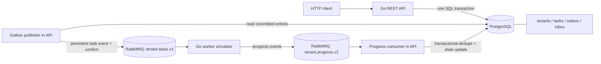
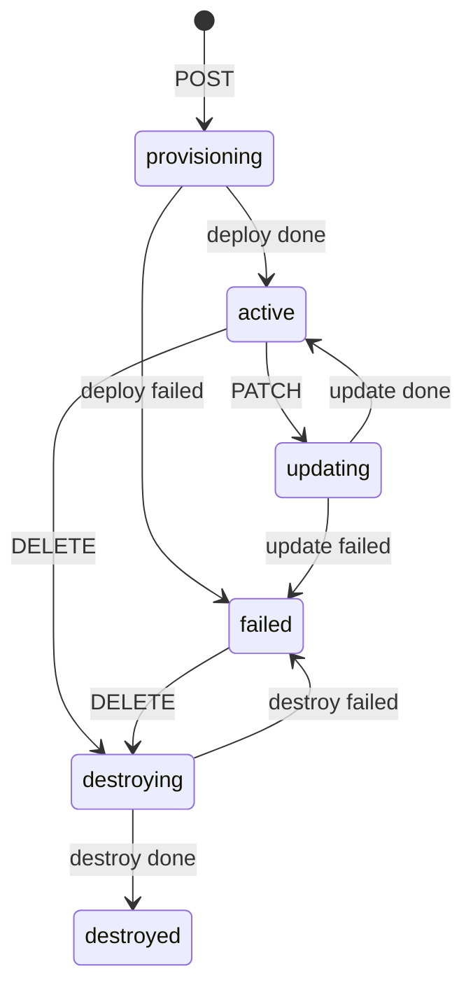
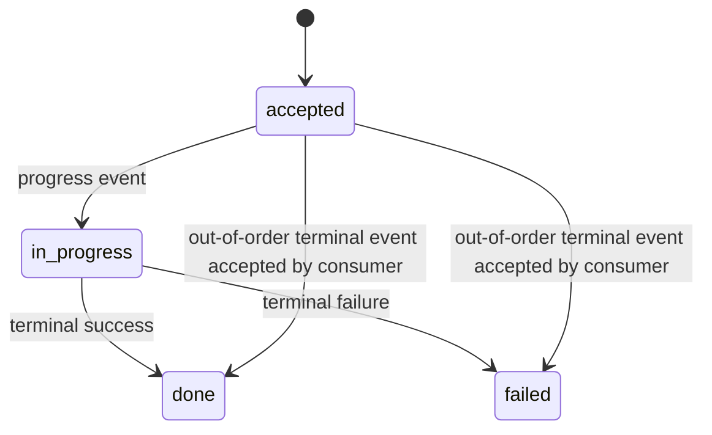
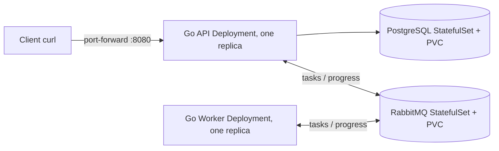

# Tenant Provisioning Control Plane

**Take-home POC | Go 1.23 · PostgreSQL 16 · RabbitMQ · Docker Compose**

An asynchronous control plane for provisioning multi-tenant SaaS environments. An HTTP request commits a **tenant**, **task**, and **outbox message** in one PostgreSQL transaction. A publisher sends the task to RabbitMQ after the commit. A configurable worker simulates the operation and publishes progress. An inbox-backed consumer applies updates without replaying duplicates or regressing terminal states.

> **Submission status:** This repository is an implementation POC, not a production-ready service. The source and tests have been reviewed, but a complete Docker build and integration run have **not been verified in this environment**. Run `make check` on your own machine and capture the results before submitting. The publicly accessible GitHub URL must also be supplied separately.

> **Security:** Default DB and broker credentials are **local development placeholders only**. The API has no authentication, HTTPS, or authorization. Do **not** expose this stack to an untrusted network.

## 1. Quick start — evaluator copy/paste

**Prerequisites:** Docker Engine/Desktop with Compose v2; `make` for the Makefile workflow; `curl` and Python 3 for command-line API examples. For `make fmt`, install Go locally. The first build may need internet access to download images and Go modules.

```bash
git clone <YOUR-PUBLIC-GITHUB-REPO-URL>
cd tenant-control-plane-poc
make up
make health
make check
```

The exact underlying Compose commands are:

```bash
docker compose up --build -d
docker compose --profile test run --rm test
```

**Local endpoints:** API at `http://localhost:8080`; health at `http://localhost:8080/healthz`; RabbitMQ management UI at `http://localhost:15672` (`guest` / `guest`, local only). A separate worker is automatically started by Compose; it requires no manual trigger.

```bash
make ps
make logs                    # Ctrl-C stops log streaming, not the containers
make down                    # preserves the PostgreSQL named volume
make reset                   # DESTRUCTIVE: deletes persistent local data
```

> **Important:** The examples use a particular repository directory name. If your GitHub repository is named differently, use its actual cloned directory.

## 2. Architecture and data flow



**Create request path**

1. Validate the slug and tenant name.
2. Insert a tenant with status `provisioning` and version `1`.
3. Insert a persisted `deploy` task with status `accepted`.
4. Insert an outbox payload containing `id`, `type`, `tenant_id`, `status`.
5. Commit all three writes atomically. Nothing is published before the commit.
6. Poll the committed outbox and publish its task to RabbitMQ; mark it published after broker confirmation.
7. The worker consumes the task and sends `in_progress`, followed by `done` or `failed`.
8. The control-plane consumer deduplicates by `event_id` and applies monotonic task/tenant transitions transactionally.
9. Clients observe progress via `GET /v1/tenants/{id}` and task endpoints.

**Delivery guarantee:** This is **at-least-once**, not physically exactly-once. If the publisher crashes after the broker confirms but before `published_at` is saved, the same task may be published again. Stable progress identifiers, the `inbox` table, and terminal-state guards make replays safe. The assignment's “publish exactly one event” is treated as **one logical outbox event per committed task**, not a claim of exactly one physical broker delivery.

### Code layout

```text
.
├── cmd/
│   ├── api/main.go                 # HTTP handlers + outbox publisher + progress consumer
│   └── worker/main.go              # Configurable provisioning simulator
├── internal/
│   ├── core/core.go                # Task and tenant state transition rules
│   ├── messaging/messages.go       # Task/progress wire envelopes and queue names
│   └── store/
│       ├── schema.sql              # PostgreSQL tables and indexes
│       └── store.go                # Transactional tenant/task persistence
├── scripts/
│   ├── publish.go                  # Inject duplicate, stale, poison progress messages
│   └── test.sh                     # Static analysis, unit/race and integration suite
├── tests/integration_test.go       # Lifecycle, concurrency and messaging tests
├── compose.yaml
├── Dockerfile
├── Makefile
├── go.mod
└── README.md
```

## 3. Domain model and state machines

### Tenant

| Field | Meaning / validation |
|---|---|
| `id` | Server-generated UUID string |
| `slug` | Unique forever, even after destruction; regex `^[a-z][-a-z0-9]{1,26}[a-z0-9]$` (3–28 chars) |
| `name` | Nonempty after trimming whitespace |
| `status` | `provisioning`, `active`, `updating`, `destroying`, `destroyed`, `failed` |
| `version` | Starts at 1; increments on API mutation and terminal worker-applied tenant mutation |
| `created_at`, `updated_at` | UTC, ISO 8601, millisecond precision, `Z` suffix |

### Task

| Field | Meaning |
|---|---|
| `id` | Server-generated UUID; also the **outbound event ID** |
| `type` | `deploy`, `update`, `destroy` |
| `tenant_id` | Parent tenant |
| `status` | `accepted`, `in_progress`, `done`, `failed` |
| `created_at`, `updated_at` | UTC timestamps with milliseconds |

One open task (`accepted` or `in_progress`) is permitted per tenant. A partial unique index enforces this as additional defense in depth.

### Tenant transitions



### Task transitions



The assignment defines the normal worker progression as `accepted → in_progress → done|failed`. The consumer deliberately accepts a terminal update directly from `accepted` to tolerate out-of-order delivery. Once a task is terminal, subsequent progress events cannot change it.

## 4. REST API contract

| Method | Endpoint | Success | Behavior |
|---|---|---|---|
| `POST` | `/v1/tenants` | `201 Created` | Creates `provisioning` tenant and `accepted` deploy task |
| `GET` | `/v1/tenants?limit=50&offset=0` | `200 OK` | Lists tenants; `limit` 1–200; includes destroyed |
| `GET` | `/v1/tenants/{id}` | `200 OK` | Retrieves tenant |
| `PATCH` | `/v1/tenants/{id}` | `202 Accepted` | Requires `name` and matching `version`; only from `active` |
| `DELETE` | `/v1/tenants/{id}` | `202 Accepted` | Asynchronous destruction from `active` or `failed` |
| `GET` | `/v1/tasks?tenant_id={id}&limit=50&offset=0` | `200 OK` | Lists tasks; optional tenant filter |
| `GET` | `/v1/tasks/{id}` | `200 OK` | Retrieves task |
| `GET` | `/healthz` | `200 OK` | Checks API and PostgreSQL availability |

**Response conventions:** successful mutating requests return both `tenant` and `task`. List endpoints return `items`, `limit`, `offset`. Delete is asynchronous: the tenant record remains and eventually reaches `destroyed` (no physical row deletion).

Example structured error:

```json
{
  "error": {
    "code": "tenant_version_conflict",
    "message": "version must match current tenant"
  }
}
```

| HTTP status | Error code | Meaning |
|---|---|---|
| `400` | `invalid_request` | Invalid JSON, slug, name, version, or pagination |
| `404` | `tenant_not_found` | Unknown tenant |
| `404` | `task_not_found` | Unknown task |
| `409` | `tenant_already_exists` | Slug collision, including a destroyed tenant |
| `409` | `tenant_update_not_allowed` | Mutation prohibited by current state |
| `409` | `tenant_version_conflict` | PATCH used a stale version |
| `405` | `method_not_allowed` | Unsupported HTTP method |
| `500` | `internal_error` | Unexpected server-side failure |

## 5. End-to-end demo: create → update → destroy

Start services first with `make up`. Use a fresh unique slug for each demo because slugs remain reserved after destruction.

### Step A — create

```bash
BASE=http://localhost:8080
SLUG="tenant-demo-$(date +%s)"
RESPONSE=$(curl -fsS -X POST "$BASE/v1/tenants" \
  -H 'Content-Type: application/json' \
  -d "{\"slug\":\"$SLUG\",\"name\":\"Demo Tenant\"}")
echo "$RESPONSE"
TENANT_ID=$(printf '%s' "$RESPONSE" | python3 -c 'import json,sys; print(json.load(sys.stdin)["tenant"]["id"])')
TASK_ID=$(printf '%s' "$RESPONSE" | python3 -c 'import json,sys; print(json.load(sys.stdin)["task"]["id"])')
```

Expected initial tenant `provisioning`, deploy task `accepted`. Worker progress should transition the task to `in_progress`, then `done`; tenant becomes `active`. Because the default worker is fast, intermediate states may not be visible unless polling rapidly or increasing its configured delay.

```bash
curl -s "$BASE/v1/tenants/$TENANT_ID"
curl -s "$BASE/v1/tasks/$TASK_ID"
curl -s "$BASE/v1/tasks?tenant_id=$TENANT_ID"
```

### Step B — update

**Wait until the tenant is `active` before continuing.** PATCH requires its current `version`:

```bash
VERSION=$(curl -fsS "$BASE/v1/tenants/$TENANT_ID" \
  | python3 -c 'import json,sys; print(json.load(sys.stdin)["version"])')
curl -i -X PATCH "$BASE/v1/tenants/$TENANT_ID" \
  -H 'Content-Type: application/json' \
  -d "{\"name\":\"Renamed Tenant\",\"version\":$VERSION}"
```

Expected immediate state `updating` and new `update` task; eventual tenant state `active` or `failed` depending on worker outcome. Default worker normally succeeds.

### Step C — destroy

**Wait for the update to finish with tenant status `active`.**

```bash
curl -i -X DELETE "$BASE/v1/tenants/$TENANT_ID"
curl -s "$BASE/v1/tenants/$TENANT_ID"
curl -s "$BASE/v1/tasks?tenant_id=$TENANT_ID"
```

Expected immediate tenant state `destroying`, eventual `destroyed`. Creating another tenant with `$SLUG` must return `409 tenant_already_exists`.

## 6. Messaging envelopes and queues

**Task queue:** `tenant.tasks.v1`, durable. **Progress queue:** `tenant.progress.v1`, durable. Messages use persistent delivery mode.

Outbound task event — the persisted task itself is the logical event:

```json
{
  "id": "<task-uuid>",
  "type": "deploy",
  "tenant_id": "<tenant-uuid>",
  "status": "accepted"
}
```

Inbound progress event (worker-generated):

```json
{
  "event_id": "<task-uuid>:in_progress",
  "task_id": "<task-uuid>",
  "status": "in_progress"
}
```

For terminal updates, `event_id` is `<task-uuid>:done` or `<task-uuid>:failed`. These stable identifiers are suitable for replay deduplication. The worker receives each task, publishes progress with broker confirmations, then acknowledges its task message.

**Deduplication and ordering:** `inbox(event_id)` is unique; the inbox insert and state changes commit together. A repeated `event_id` changes nothing. Distinct stale events received after a terminal outcome also change nothing. Tenant row locks serialize worker terminal updates with HTTP mutations.

## 7. Failure injection and negative scenarios

### A. Force provisioning failures

```bash
make failure-worker
# Create a NEW tenant using the Step A command.
# Expected: deploy task 'failed'; tenant 'failed'.
make restore-worker
```

Equivalent worker flags are `--fail-rate=1 --min-delay-ms=200 --max-delay-ms=500` (`fail-rate=0` means all simulated tasks succeed). For manual overrides, the Makefile uses a separate `tenant-fail-worker` container.

**Caution:** Do not leave the default and failure workers running concurrently: they will compete for tasks, making the outcome nondeterministic.

### B. Duplicate / stale progress

For a real completed `TASK_ID`, inject the same stale message twice:

```bash
TASK_ID=<REAL-COMPLETED-TASK-ID>
docker compose --profile test run --rm --entrypoint go test \
  run ./scripts/publish.go --task-id "$TASK_ID" \
  --event-id "manual-stale-$TASK_ID" --status in_progress
# Repeat the exact command.
```

Expected: the completed task and tenant remain unchanged. Use `GET /v1/tasks/$TASK_ID` and `GET /v1/tenants/$TENANT_ID` to verify. (The script publishes the message; it does not assert state itself.)

### C. Poison message

```bash
docker compose --profile test run --rm --entrypoint go test \
  run ./scripts/publish.go --raw '{not-json}'
make logs-api
```

Expected: consumer logs invalid JSON, acknowledges the poison message, and keeps processing subsequent valid messages. The POC has **no dead-letter queue**.

### D. Deterministic out-of-order terminal update

1. Stop the worker: `docker compose stop worker`.
2. Create a fresh tenant and capture its accepted task ID.
3. Inject a `done` update for that task with a unique `event_id` using `scripts/publish.go`.
4. Inject a later `in_progress` event with a **different** `event_id`.
5. Verify the task stays `done`, the tenant stays `active`, and its version does not change on the stale update.
6. Restart the worker with `make restore-worker`. Its late delivery must not regress the terminal task.

## 8. Concurrency and persistence tests

### Required race: two PATCHes using the same tenant version

`tests/integration_test.go` includes `TestConcurrentPatchSameVersion`. Both callers send the same version to an active tenant; the expected result is **one `202` success and one `409` conflict**. PostgreSQL `SELECT ... FOR UPDATE` serializes the operations. The first change increments `version`; the second sees the new version and fails.

### Duplicate create race

`TestConcurrentCreateSlug` concurrently attempts two creates with the same slug; the expected result is one `201`, one `409 tenant_already_exists`. The unique database constraint protects correctness independently of application-layer checks.

### Messaging replay

`TestDuplicateAndStaleProgress` injects duplicate terminal updates and stale progress against a completed task, and asserts the tenant remains active with the same version.

### Persistence across restart

```bash
make up
# create a tenant, record TENANT_ID
make restart
curl -s "http://localhost:8080/v1/tenants/$TENANT_ID"
# expected: record still exists
```

The database uses a named Docker volume `postgres_data`. `make down` preserves it; **`make reset` deletes it**.

## 9. Development and quality gates

| Command | Purpose |
|---|---|
| `make help` | Show Makefile targets |
| `make up` | Build and run API, DB, broker, worker |
| `make build` | Build API and worker images |
| `make health` | HTTP health check |
| `make ps` | Show service health/status |
| `make logs` | Follow API and worker logs |
| `make fmt` | Apply `gofmt` locally; requires Go on host |
| `make fmt-check` | Fail if any Go file is unformatted |
| `make lint` | Run `go vet ./...` |
| `make unit` | Go package tests with race detector (without integration tag) |
| `make integration` | Boot stack and run `scripts/test.sh` |
| `make test` | Same full test workflow as integration |
| `make check` | Formatting check + full tests |
| `make failure-worker` | Start guaranteed-failing worker instead of default |
| `make restore-worker` | Restore default worker |
| `make down` | Stop without deleting persistent DB volume |
| `make reset` | Destroy local containers **and** DB volume |

The current `scripts/test.sh` runs:

```bash
go vet ./...
go test ./... -race -count=1
go test -tags integration ./tests -race -count=1 -v
```

A security scanner is optional under the brief and **is not currently wired into these commands**. Formatting is validated by `make fmt-check`, separately from `scripts/test.sh`.

## 10. Database correctness and design decisions

| Decision | Reason | Trade-off |
|---|---|---|
| PostgreSQL with explicit SQL | Simple, inspectable transaction and lock behavior | More manual SQL than an ORM |
| Tenant `FOR UPDATE` row lock | Serializes conflicting mutations and worker status transitions | Write contention for the same tenant |
| Unique `slug` index | Enforces permanent uniqueness even under races | Cannot recycle destroyed slugs |
| Partial unique index on open tasks | Prevents simultaneous active tasks for one tenant | Must align with state-machine guards |
| Atomic outbox row | Prevents committed changes without a record to publish | A polling publisher introduces short delay |
| RabbitMQ publisher confirms | Ensures broker acknowledgement before marking sent | Duplicate physical sends still possible on crash |
| Inbox unique `event_id` | Makes worker progress replay-safe | Inbox grows and needs operational retention policies |
| Single API instance in POC | Keeps current outbox polling straightforward | Multi-replica polling requires claim/lease coordination |

Current implementation uses a fixed 350 ms outbox polling interval, `READ COMMITTED` isolation with row locks, durable queues, and basic reconnection loops. It is a **single-instance proof of correctness**, not a horizontally scaled production architecture.

## 11. Local deployment vs. optional Minikube extension

**Assignment-required deployment:** Docker Compose only, all dependencies locally bootable through `make up`. The take-home brief does **not** require Kubernetes manifests or cloud infrastructure.

**Optional Minikube extension:** included in `k8s/` and the `k8s-*` Makefile targets. See the Minikube section below. Docker Compose remains the required single-command assignment boot path.

## 12. Known limitations / pre-submission checklist

- [ ] Run `make up` on a clean Docker host and verify `/healthz`.
- [ ] Run `make check`; resolve any build, formatting, lint or test failures.
- [ ] Execute create/update/delete, including task detail and list APIs.
- [ ] Demonstrate the same-version PATCH race: exactly one success.
- [ ] Demonstrate simultaneous duplicate-slug creates: exactly one success.
- [ ] Demonstrate forced worker failure, duplicate progress, stale progress and poison JSON.
- [ ] Restart API and ensure tenant records persist.
- [ ] Verify all README commands in the target shell (Linux/macOS/WSL recommended).
- [ ] Replace example GitHub URL and publish as a **public** repository with a clean commit history.
- [ ] Ensure the public repo contains **no actual credentials, API keys or `.env` secrets**.

**Implementation boundaries to explain at code review:** no auth/TLS; placeholder local passwords in Compose; no DLQ; no bounded retry/dead-letter policies; basic reconnect backoff; no graceful shutdown or metrics; no multi-instance-safe outbox claiming; no migration versioning; no complete security-scanner gate. The brief prefers correctness over unnecessary platform breadth.

### Candidate walkthrough: five decisions to be able to defend

1. **Why a transactional outbox?** Because a DB commit and RabbitMQ publication cannot be committed atomically with the current architecture; the outbox ensures publication never precedes durable state.
2. **Why version numbers and row locks?** Because concurrent PATCHes must not silently overwrite one another; the second caller must observe a version conflict.
3. **Why inbox deduplication?** Because at-least-once delivery permits worker updates to be replayed.
4. **Why terminal-state guards?** Because out-of-order or late `in_progress` messages cannot turn a completed task back into an unfinished task.
5. **Why one API replica?** Because the current outbox poller lacks multi-instance row claiming; adding `FOR UPDATE SKIP LOCKED`, a lease, or a dedicated publisher would be needed before scaling horizontally.

---

**Source of requirements:** `Control_Plane_CANDIDATE_BRIEF.md`. This README documents this repository's selected Go/PostgreSQL/RabbitMQ implementation, and identifies optional operational enhancements separately.


## 13. Optional Minikube deployment (local Kubernetes POC)

This is an **extension** beyond the candidate brief: it does not replace the `make up` Docker Compose submission path. Tested commands below target Linux/WSL with Docker, `kubectl`, `minikube`, and GNU Make. **The end-to-end Minikube rollout has not been executed in this environment.**

### Architecture



The worker has **no HTTP API, Service, or Ingress**; it connects outbound to RabbitMQ. The API alone exposes a ClusterIP Service. The Go API executes `Migrate` when it starts, so no migration Job is required. `imagePullPolicy: Never` requires loading both images into Minikube before deploy.

### Use your existing `gpu-cpu-lab` Minikube profile

The Makefile and Secret script default to **`gpu-cpu-lab`**. All Kubernetes commands go through `minikube -p gpu-cpu-lab kubectl --`, avoiding any dependence on the current `kubectl` context. Image loading uses the same profile.

```bash
minikube profile list
minikube -p gpu-cpu-lab status
make k8s-profile
minikube -p gpu-cpu-lab kubectl -- get nodes
```

If the profile is stopped, start **that profile**, not the default one:

```bash
minikube start -p gpu-cpu-lab --driver=docker
```

You may override the profile for another environment: `make k8s-up MINIKUBE_PROFILE=other-profile` or `MINIKUBE_PROFILE=other-profile bash scripts/minikube-secrets.sh`.

**Caution:** `make k8s-wipe` deletes the entire `tenant-control-plane` namespace and its PVCs on the selected profile; it does not delete the whole Minikube cluster.

### Deploy with Makefile

```bash
# Choose fresh local-only values. Avoid special characters for URL-safe credentials.
export DB_PASSWORD='replaceWithLocalDbPassword123'
export RABBITMQ_PASSWORD='replaceWithLocalMqPassword123'

make k8s-up       # build both images, load into Minikube, create Secret, apply YAML, await rollout
make k8s-status
```

`k8s-up` runs `k8s-build`, `k8s-secrets`, and the profile-scoped Kubernetes apply/rollout steps. The password environment variables are needed when creating or refreshing Secrets. They are not committed to Git. For production use, replace this local-secret method with a proper secret manager, TLS, and access policies. The Minikube deployment uses the `tenant-control-plane` namespace and a PVC for each dependency. PostgreSQL and RabbitMQ are intentionally single-instance to keep the demo small.

### Port-forward and exercise lifecycle

In terminal 1:

```bash
make k8s-port-forward
```

In terminal 2:

```bash
curl -fsS http://localhost:8080/healthz
curl -sS -X POST http://localhost:8080/v1/tenants \
  -H 'Content-Type: application/json' \
  -d '{"slug":"minikube-demo-01","name":"Minikube Demo"}'
# Inspect tenant/task identifiers returned by POST:
curl -sS 'http://localhost:8080/v1/tenants'
curl -sS 'http://localhost:8080/v1/tasks'
```

After worker processing, task becomes `done` and tenant becomes `active`. Note that `minikube-demo-01` is persistent and globally unique per database even after destroyed status; use a new slug on reruns.

### Reproducible failure and restart

```bash
make k8s-failure-worker # guarantees failure of NEW tasks after rollout
# Now create a NEW tenant with a different slug using the POST command above.
make k8s-restore-worker
minikube -p gpu-cpu-lab kubectl -- -n tenant-control-plane logs deploy/tenant-api --tail=100
minikube -p gpu-cpu-lab kubectl -- -n tenant-control-plane logs deploy/tenant-worker --tail=100
minikube -p gpu-cpu-lab kubectl -- -n tenant-control-plane rollout restart deploy/tenant-api
minikube -p gpu-cpu-lab kubectl -- -n tenant-control-plane rollout status deploy/tenant-api
```

Persistent tenant data should remain after restarting the API. The consumer's duplicate/out-of-order behavior should be exercised using `scripts/publish.go` with the broker credentials and an appropriate in-cluster execution environment, or the original Compose integration suite. `make check` is still the full documented Compose test command; Kubernetes-specific automated testing is a future enhancement.

### Troubleshooting

```bash
minikube -p gpu-cpu-lab kubectl -- -n tenant-control-plane get pods,svc,pvc
minikube -p gpu-cpu-lab kubectl -- -n tenant-control-plane describe pod <pod-name>
minikube -p gpu-cpu-lab kubectl -- -n tenant-control-plane logs deploy/tenant-api --tail=100
minikube -p gpu-cpu-lab kubectl -- -n tenant-control-plane logs deploy/tenant-worker --tail=100
minikube -p gpu-cpu-lab kubectl -- -n tenant-control-plane get events --sort-by=.lastTimestamp
minikube -p gpu-cpu-lab image ls
```

- `ImagePullBackOff` / `ErrImageNeverPull`: images were not loaded into the selected Minikube profile; run `make k8s-build` then restart Deployments.
- `Pending` database/broker pods: check PVC binding, storage class (`minikube -p gpu-cpu-lab kubectl -- get storageclass`) and available Minikube resources.
- RabbitMQ authorization: `guest` is intentionally **not** used over the network; the generated Secret provides `app` credentials.
- Re-run `make k8s-secrets` only when provisioning a new cluster/namespace. The script preserves the existing RabbitMQ Erlang cookie, but rotating passwords of existing StatefulSets is **not automatic** and can require coordinated data-store credential rotation or a clean local reset.
- Existing images with unchanged `:dev` tags: after `make k8s-build`, restart the API and worker Deployments to run the rebuilt binaries.
- Keep API replica count at **1**: outbox polling currently lacks distributed claiming and multi-replica publishing can duplicate work.

### Cleanup

```bash
make k8s-down  # delete workloads and Services; retain namespace and persistent PVCs
# For an explicit full teardown including persistent data:
make k8s-wipe  # WARNING: removes all namespace resources and namespace PVCs
```

For a clean local teardown, prefer `make k8s-wipe` only after checking `kubectl config current-context`. The `k8s-down` target leaves the namespace and PVCs in place, although deleting StatefulSets shuts down the DB and broker. To stop only the application while keeping the DB and broker running, use `minikube -p gpu-cpu-lab kubectl -- -n tenant-control-plane scale deployment/tenant-api deployment/tenant-worker --replicas=0`.
